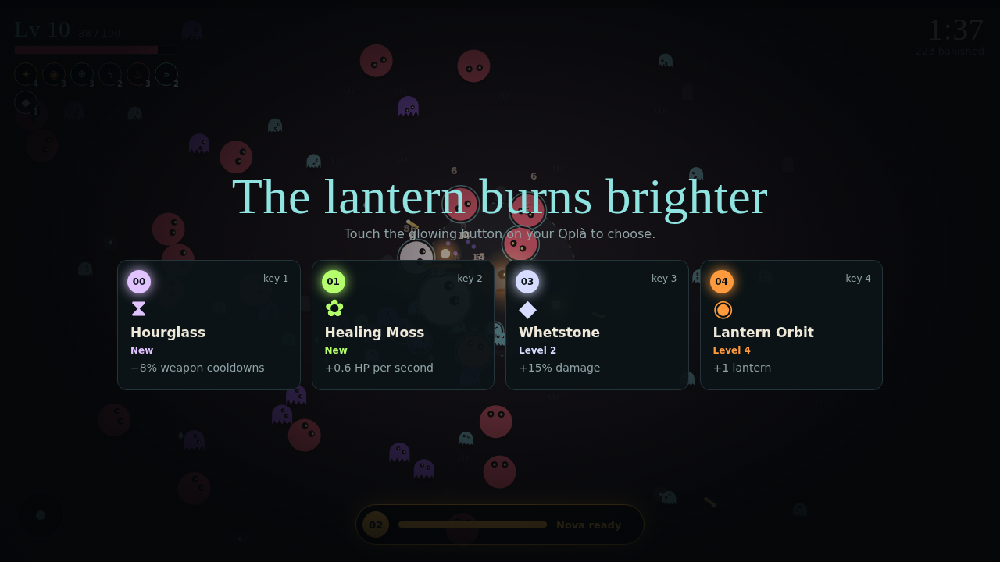

# Tiltlight

A survivors-style browser game you play by **tilting an Arduino Oplà IoT Kit**.

You carry a lantern across a dark moor full of ghosts. Your weapons fire on their own, so all you do is move — by tilting the Oplà — and pick upgrades with its touch buttons. The Oplà talks back: its LEDs, buzzer and round screen react to what happens in the game.



## How it works

The Oplà streams its accelerometer readings to the browser over USB using the [Web Serial API](https://developer.mozilla.org/en-US/docs/Web/API/Web_Serial_API). The game turns the tilt into analog movement and sends events back, so the controller can flash, buzz and show your stats.

| On the Oplà | What it does |
| --- | --- |
| Tilt | Move (analog, 360°) |
| Button **02** | Lantern Nova, the super ability. Charges as you defeat enemies; LED 02 pulses gold when it’s ready |
| Buttons **00, 01, 03, 04** | Pick an upgrade when you level up: touch and **hold for 2 seconds**, so a stray touch while tilting can't choose. Each button’s LED lights in the colour of its card and fills up while you hold |
| LEDs + buzzer | Red flash when you’re hit, jingle on level-up, sweep sound on Nova |
| Round screen | Level, HP and time survived |

## What you need

- [Arduino Oplà IoT Kit](https://store.arduino.cc/products/arduino-opla-iot-kit) (MKR WiFi 1010 + MKR IoT Carrier)
- A USB cable
- Chrome or Edge on desktop (Web Serial isn’t supported in Firefox or Safari)
- [Arduino IDE](https://www.arduino.cc/en/software)

## Setup

### 1. Flash the controller

1. In the Arduino IDE, install **Arduino_MKRIoTCarrier** from the Library Manager.
2. Open `firmware/tiltlight_controller/tiltlight_controller.ino`.
3. Select **Arduino MKR WiFi 1010** as the board, pick its port, and upload.
4. Close the Serial Monitor, since only one program can use the port at a time.

If your Oplà is not in its plastic case, set `USING_PLASTIC_CASE = false` at the top of the sketch.

**Using PlatformIO instead?** Put the sketch in your project's `src/` folder. PlatformIO doesn't link the precompiled part of Bosch's BSEC library that the carrier library depends on, so the build fails with `undefined reference to 'bsec_init'`. Add this line to your `platformio.ini` to fix it, adjusting the path to your Arduino libraries folder:

```ini
build_flags = -L"C:/Users/<you>/Documents/Arduino/libraries/BSEC_Software_Library/src/cortex-m0plus" -lalgobsec
```

### 2. Play

Play the hosted version on GitHub Pages (see below), or run it locally. The game is split into JavaScript modules, which browsers only load from a web server, so double-clicking `index.html` won't work. To run it locally, install [Node.js](https://nodejs.org/) and run:

```sh
npm start
```

Then open <http://localhost:8080> in Chrome or Edge. Any static server works too, for example VS Code's *Live Server* extension or `python -m http.server`.

1. Click **Connect Oplà** and choose the board’s port.
2. Tilt the board and check that the dot in the preview circle follows you.
3. Hold the Oplà in a comfortable position and touch **02**. That pose becomes “standing still”.

### Keyboard controls

You can play without the Oplà too: `WASD` or arrow keys to move, `1`–`4` to pick upgrades, `Space` for the Nova, `C` to recalibrate and `P` to pause.

## Progression

Every night you survive earns **embers**, based on how long you lasted, how many enemies you banished and the level you reached. Spend them at **camp** (the start screen) on permanent upgrades:

| Upgrade | Per rank | Ranks |
| --- | --- | --- |
| Vigor | +10 max HP | 5 |
| Stride | +4% move speed | 5 |
| Might | +5% damage | 5 |
| Haste | −3% weapon cooldowns | 5 |
| Reach | +15% pickup range | 4 |
| Kindling | Start with +15% Nova charge | 4 |
| Fortune | +10% embers earned | 4 |
| Second Wind | Get back up once per night at half HP | 1 |

Camp also tracks your records: longest night, highest level, most banished and nights walked. On the Oplà, `00` and `04` move between upgrades and `01` buys one.

### Where progress is saved

Progress is saved automatically in your browser’s local storage, so it stays on your computer and isn’t part of this repository. Each browser and each address keeps its own save, which means playing on `localhost` and on GitHub Pages gives you two separate saves.

To move a save, use **Export save** to download `tiltlight-save.json` and **Import save** on the other side. Save files are listed in `.gitignore`, so an exported save in the project folder won’t be committed by accident.

## Tuning

- **Holding the Oplà upside down?** Tick *I hold the Oplà upside down*. The level-up cards and the pad map then match what you see, and the board's screen turns around. Touch a pad on the start screen and check that the matching dot lights up.
- **Movement goes the wrong way?** Use *Flip left and right*, *Flip up and down* or *Swap axes* on the start screen. Settings are saved in your browser.
- **Too twitchy or too sluggish?** Adjust the *Sensitivity* slider.
- **LED colours look wrong?** Swap the colour order in `setLed()` in the sketch.

## Hosting on GitHub Pages

Web Serial needs a secure page, and GitHub Pages is served over HTTPS, so the game works from there.

1. Go to **Settings → Pages** in this repository.
2. Under *Build and deployment*, choose **Deploy from a branch**, select `main` and `/ (root)`, and save.
3. After a minute the game is live at `https://<your-username>.github.io/<repo-name>/`.

## Serial protocol

115200 baud, one message per line.

**Oplà → game**

| Message | Meaning |
| --- | --- |
| `A,<ax>,<ay>` | Accelerometer X and Y in g, about 60 per second |
| `B,<n>` | Touch button `n` (0–4) pressed |
| `E,<n>` | Touch button `n` released |

**Game → Oplà**

| Message | Meaning |
| --- | --- |
| `H` | Player was hit |
| `U,<c0>,<c1>,<c3>,<c4>` | Level-up; hex colours (RRGGBB) for buttons 00, 01, 03, 04 |
| `C` | Upgrade chosen |
| `S,<0-100>` | Nova charge |
| `N` | Nova used |
| `D,<hp>,<maxHp>,<level>,<seconds>` | Stats for the round screen |
| `G` | Game over |
| `R` | New run |
| `O,<0\|1>` | Board held upright (0) or upside down (1); the screen rotates to match |

## Project structure

Plain HTML, CSS and JavaScript modules. There is no build step and no dependencies.

```
.
├── index.html              Page markup: HUD, title/camp, level-up and game-over screens
├── css/
│   ├── base.css            Design tokens, reset, buttons, shared text styles
│   ├── overlays.css        Full-screen overlay and panel
│   ├── hud.css             In-run HUD
│   ├── title.css           Title screen, controller setup and camp
│   ├── levelup.css         Level-up cards
│   └── gameover.css        Run summary
├── js/
│   ├── main.js             Entry point: wires everything up and runs the frame loop
│   ├── app/
│   │   └── controller.js   Game modes (title, play, levelup, paused, over) and input routing
│   ├── config/             Data only: upgrades, enemies, camp perks, balance, pads, colours
│   ├── game/               The simulation (no DOM): run state, world step, weapons,
│   │                       spawning, combat, upgrades and saved progression
│   ├── hardware/
│   │   ├── serial.js       Web Serial connection (lines in, lines out)
│   │   └── board.js        The Tiltlight protocol: parses and sends every message
│   ├── input/              Tilt, keyboard, combined movement and controller settings
│   ├── render/             Canvas drawing: scene, ground, entities, tilt dial
│   ├── ui/                 DOM screens: HUD, level-up cards, camp, setup, game over
│   └── core/               Small helpers: DOM, maths, storage, screen size
├── tests/                  Unit tests for the simulation, progression and protocol
├── firmware/tiltlight_controller/
│   └── tiltlight_controller.ino   Arduino sketch for the Oplà
└── docs/
    └── screenshot.png
```

Dependencies only point one way: `config` and `core` depend on nothing, `game` only uses `config`, `core` and `hardware/board.js`, and only `ui`, `render` and `app` touch the page. That's why the simulation can be tested in Node without a browser.

### Changing the game

- **Balance a weapon, enemy or perk:** edit the numbers in `js/config/`.
- **Add an enemy:** add an entry to `js/config/enemies.js` and pick it in `pickType()` in `js/game/spawn.js`.
- **Add a passive or treat:** add it to `UPGRADES` in `js/config/upgrades.js` and its effect to `EFFECTS` in `js/game/upgrades.js`.
- **Add a weapon:** add it to `UPGRADES` and `WEAPON_STATS` in `js/config/upgrades.js`, its behaviour to `FIRE` in `js/game/weapons.js`, and how it looks to `js/render/entities.js`.
- **Add a serial message:** add it to `js/hardware/board.js`, the sketch, and the protocol table above.

### Tests

```sh
npm test
```

Uses Node's built-in test runner (Node 18 or newer). The tests play whole runs with a seeded random generator, so a failure always reproduces.

## Ideas

- Shake the Oplà to dash, using the gyroscope
- Boss fights
- Play wirelessly over the MKR WiFi 1010’s WiFi
- Use the Oplà’s temperature or light sensor to change the weather in the game

## License

MIT, see [LICENSE](LICENSE).
